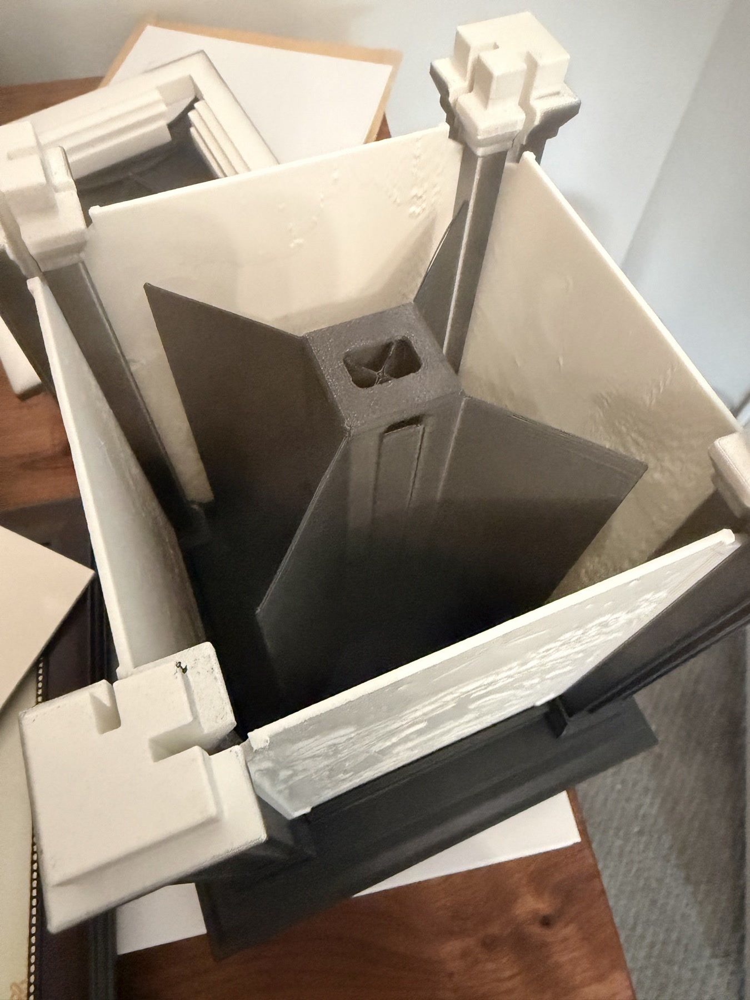

# Standard lighting architectures

Use these names consistently in every lantern project. Record the selected architecture in the project checkpoint before functional blockout. General lighting method shared with the other families (WLED scenes and presets, boards, light-path tests) is in [lighting and electronics](../../../shared/lighting-and-electronics/lighting-and-electronics.md) (`shared/lighting-and-electronics/lighting-and-electronics.md`).

## Split lighting

Selecting **split lighting** imports the following system together. Do not substitute a generic PCB, battery, divider, or LED layout while continuing to call the result split lighting. Record any explicit exception as a project-specific departure.

### Swappable hardware plate (controller interface)

The controller board is not fixed and may change between builds, so the lantern never carries fixed board mounts. Instead:

- The base provides a cavity limit for any hardware set, one standard port window at the service face, and screw tabs or inserts for a removable plate. Record these numbers in a `hardware-interface.json` beside the print scripts.
- Each hardware set gets its own plate: a floor plate that closes the cavity, with an upright bulkhead behind the port window carrying that board's USB-C and switch cutouts, plus its standoffs. Generate it from a small spec (`hardware_plate.py spec.json out.stl` in Bag End v1) and ship a blank plate in every release.
- The LEDs stay on the divider or LED post, so changing boards never moves the lights relative to the panels.
- Every plate, the blank included, carries the lid tie-down anchor cup on the lantern's axis, and no board, standoff or wire may enter the 24 mm tie keep-out column (see engineering, lid tie-down). `hardware_plate.py` should add the cup and refuse anything inside the keep-out.
- Patterns in use: Bag End (3 mm floor plate, 2.4 mm bulkhead behind a 15 × 26 mm port window, three M3 screws into 2.5 mm pilots); Lonely Mountain (floor plate on four M3 heat-set inserts in 4.2 mm holes); Dragon (216 mm disc in a 3.6 mm recess, four M3 at r 102, 64 × 26 mm back port panel). None is physically tested yet.

The board and power details below are the reference hardware set the plate and cavity must accommodate, not fixed mounts.

### Controller and power baseline

- Controller PCB proposal: 88 × 50 × 1.6 mm with 3 mm corner radius.
- Minimum board cavity: 94 × 56 × 25 mm.
- Wired controller envelope: 94 × 85 × 25 mm, excluding the separate antenna.
- Preserve a 20 mm straight USB plug approach at the service edge and 15 mm beyond the harness edge for connector bodies and wire bends.
- Four 3.2 mm mounting holes, top view from the PCB lower-left origin: `(44,4)`, `(84,4)`, `(4,46)`, `(84,46)` mm. The pattern is asymmetric; do not mirror it. Use nonconductive 3 mm standoffs.
- Controller: Seeed Studio XIAO ESP32-S3.
- LED data path: XIAO D1 / GPIO2 through an SN74AHCT125N 5 V level shifter to the `+5 V / DATA / GND` light connector.
- Retained charger/5 V boost daughterboard M1: 34.39 × 25.53 × 5 mm actual, with a 36.4 × 27.5 mm plan reservation.
- Battery: protected 3.7 V single cell, 40 × 65 × 12 mm actual. Reserve a provisional 42 × 67 × 14 mm removable, non-compressive pocket with strain relief and an extraction path.
- XIAO battery pads remain unused. Add the required Schottky isolation diode between external `+5V_SYS` and the XIAO 5V/VBUS input before fabrication.
- The retained M1 architecture has physically operated the lights while USB-C charging in another lantern. Repeat staged powered and thermal testing in each final enclosure.
- External adhesive antenna: 38 × 19 × 3 mm; reserve at least 40 × 21 × 4 mm on a flat nonmetallic surface. Use a gentle, serviceable U.FL lead route and keep the antenna away from the battery, M1, large metal parts, and ground planes where practical.
- Power switch: optional. Reserve space at the service face for one; when David asks for it, use an SS12D00-type slide switch on the battery positive line before M1 (see engineering, service face).

### Divider and light baseline

- Use an opaque, removable divider built as a hollow central post with four radial light-blocking blades, made as separate parts (see [split divider construction](#split-divider-construction-standard)). Together, the post and blades create four face-oriented optical chambers, one per lithophane.
- Orient the divider so each of the central post's four flat faces points toward the center of one lithophane. Each lithophane sits between two adjacent radial blades; the blades form the chamber sidewalls and prevent light intended for one lithophane from spilling directly behind its neighbors.
- Run each blade outward toward the opaque corner/frame line between adjacent lithophanes. Its outer edge must meet or overlap the lantern's light-blocking frame region rather than terminate in the illuminated image field.
- Run the divider continuously between keyed base and roof seats. Preserve the hollow center as a protected vertical wiring/service passage, including usable entry and exit openings. The lid tie-down wire shares this bore, so keep a free 10 mm passage beside the LED harness. Leave at least 0.5 mm of vertical clearance at one seat so the tie tension doesn't load the divider.
- The divider must not block panel installation, panel removal, roof removal, or controller service.
- Provide one vertical recessed or positively located LED-strip channel on each of the four central post faces.
- Keep the LED-to-lithophane distance inside the proven range in the [print profile](../../../shared/print-profile/print-profile.md) (`shared/print-profile/print-profile.md`) (about 54–61 mm in David's working lanterns). Set it with the post section, strip offset and panel plane at blockout. A distance outside that range needs a one-chamber light coupon before release, not just a note.
- Mount one vertical addressable-LED strip in each channel, aimed outward toward the corresponding lithophane: four strips of equal length, `4 × N` pixels total. Keep the LEDs and channel edges clear of the two adjacent divider blades so the full lithophane field receives light.
- Standard strip: BTF-LIGHTING WS2812B, 5 V, 144 LEDs/m (pitch about 6.94 mm), Amazon ASIN B01CDTE9UC. Measure the purchased strip's width, thickness and pixel pitch before fixing the channel; record any other strip as a project-specific departure.
- Derive the pixel count per strip from the lantern, not a fixed number: `N = floor((H_field − 2 × m) / p)`, where `H_field` is the exposed lithophane image height, `m` is an end margin (start at 2 mm) and `p` is the measured pitch. Center each strip vertically on its panel's field, and use the same `N` on all four faces. Example: a 165 mm field at 144/m gives `N = 23` (about 160 mm), so 92 pixels total.
- Daisy-chain `DIN→DOUT` around the post across the four strips as one `4 × N`-pixel serial data chain connected to the controller's single light output. In this definition, “wired in serial” refers to the addressable data order; preserve a correctly sized, serviceable 5 V/GND distribution path rather than placing the strip power rails electrically in series.
- Reference firmware/load configuration: WLED with an 850 mA current limit and the LED count set to `4 × N`. The limit, not the pixel count, bounds the load: more pixels at the same limit spread the same current over a taller field. Re-check current, voltage drop, wiring, connector capacity, battery runtime, and heat before raising the limit, and confirm the voltage drop along the chain for the derived `N`.

### Split divider construction (standard)

David set this as the standard for every new split-lit lantern on 2026-11-13, from Mirkwood divider v2. It replaces the one-piece printed divider. A one-piece divider (post and blades printed together) took very long to print and often fell off its supports. Do not design one for a new lantern; record it as a project-specific departure if a lantern ever needs it. Locked lanterns that already have a one-piece divider keep it unless David asks for a retrofit.

The divider is two kinds of part:

1. **Printed core post.** A hollow square post carrying the LEDs and the wiring.
   - Square section (Mirkwood: 28 mm) with a 14 mm wire bore. The bore is still shared with the lid tie-down wire, so keep the free 10 mm passage beside the harness.
   - A small boss at each corner with a vertical slot open at the top for one blade (Mirkwood: 7.4 mm boss standing 3 mm proud, slot 3.4 mm wide and 8 mm deep). Close the slot at the bottom with a floor that sets the blade height.
   - One LED-strip channel on each face (Mirkwood: 10.6 × 0.8 mm for the standard strip) and three-wire exits into the bore at both strip ends (10 × 3.6 mm).
   - A spigot that drops into the base or plinth socket, with a shoulder that sits on the deck (Mirkwood: 24 mm spigot, 2.7 mm deep). Keep the ≥ 0.5 mm clearance under the lid or roof boss so tie tension never loads the post.
   - Print it upright and upside down (top face on the bed), with no supports and a brim. Design it so that orientation needs none: slots open toward the bed, no overhangs on the spigot. Opaque or dark PLA.
2. **Four flat blades.** Plain rectangles that slide straight down into the corner slots from above.
   - First choice: laser-cut from **3 mm opaque black cast acrylic**. White, clear or translucent acrylic glows and leaks light between chambers, so never use it.
   - Printed fallback: the same blade as a 3 mm flat plate in black or dark PLA, printed flat with no supports.
   - Size them per lantern. Length runs from the slot root to 0.5 mm short of the frame's inner corner. Height runs from the slot floor (about 0.5 mm above the deck) to just under the top caps, so the blade covers the whole lithophane field as the governing rules below require. Mirkwood: 67.0 × 254.9 mm.
   - Ship the laser file as a DXF in mm (no SVG needed), cut lines as red hairlines, nested on one 12 × 12 in (305 × 305 mm) sheet of 3 mm black (or an 8 × 10 in sheet for 1 mm blades); ship a 3MF of the printed fallback beside it. If a blade is too long for the bed, say how to turn it (Mirkwood: 45° on the A1).

**Fit.** Make the slot 0.4 mm wider than the nominal sheet (3.4 mm for 3 mm). Cast acrylic varies about 2.8–3.2 mm, so this gives a slight slip fit; tape on the blade root firms up a loose one. Clash-check the assembled post and blades against the decor, roof and frame, and keep the LED-to-panel distance in the proven 54–61 mm range.

**Assembly order.** With the lid off, seat the post in its socket, slide each blade down into its slot, then stick the strips in the face channels and feed their leads through the wire exits into the bore.

**Release.** Generate the post, the blade outline (SVG, DXF) and the printed-blade 3MF from one script so the slot width and blade size come from the same numbers. Record post section, slot width and depth, slot floor height, and blade length and height in the lantern's facts JSON.

**Not yet proven.** As of 2026-11-13 no split divider has been printed or cut. Until one has, the release must ask for one test before the full set: print the post and fit one blade (cut or printed) into one slot, checking slip fit and that the blade stands vertical. Update this section with the result.

Earlier one-piece dividers (Lonely Mountain, Bag End) used a 24 mm post, 14 mm bore, about 3 mm seats, and 2.4 mm blades with tips 0.5 mm clear of the frame's inner corners. David accepted the light-leak risk at that 0.5 mm gap (2026-11-05), and it carries over to the split blades.

### Governing divider-to-frame relationship

These relationships are part of the split-lighting definition even though their numerical dimensions change with the lantern:

- **The divider is full optical height, not a short insert.** Its body runs from a positive seat on the base/light-carrier structure to a positive seat at the underside of the roof or top frame. Its blades must block direct chamber-to-chamber sightlines across the entire exposed lithophane image height.
- **Derive its height from the inside of the assembled frame.** The governing dimension is the distance between the lower divider seat and upper divider seat, including any keyed engagement and assembly clearance. Do not derive divider height from overall lantern height or stop it at the end of the LED strip.
- **Top and bottom transitions stay behind opaque frame coverage.** A blade may end slightly above or below the physical lithophane edge only where the opaque top or bottom capture rail overlaps that region. No vertical gap may expose one illuminated chamber to another through the visible lithophane field.
- **The divider nests entirely inside the outside frame.** It is an internal optical and LED carrier, not an exterior wall, corner post, lithophane capture frame, or silhouette-defining part.
- **Each blade ends at a panel-bay junction.** In plan view, its outer tip points to and meets the inside of the opaque vertical corner/frame member between two neighboring lithophanes. It must not terminate behind the middle of a lithophane or cross its panel channel.
- **Use light-blocking overlap rather than structural substitution.** The outer frame continues to locate and retain the lithophanes. The blade end may use a keyed pocket, shallow slot, labyrinth overlap, or close removable fit at the frame's inner corner. Small assembly clearance is acceptable only when hidden by opaque overlap and shown not to leak objectionable light.
- **Keep service systems independent.** Removing the divider must not require flexing the lithophanes or dismantling the outside frame unless the project's approved assembly order explicitly says otherwise.

Simplified top section:

```text
                 LITHOPHANE
          ┌─────────────────────┐
          │      chamber        │
          │         ↑           │
          │       LED face      │
 FRAME ───●─────────□───────────●─── FRAME
          │ blade  central  blade│
          │        post          │
          │                       │
 LITHO ←  │ chamber       chamber│  → LITHO

● = opaque outside-frame junction between adjacent panel bays
□ = hollow central post; one outward-facing LED strip per face
```

Simplified vertical section:

```text
        roof / opaque top frame
      ┌──────────────────────────┐
      │ keyed upper divider seat │
      ├──────────────────────────┤ ← opaque overlap
      │                          │
      │ exposed lithophane field │ ← divider blocks full height
      │                          │
      ├──────────────────────────┤ ← opaque overlap
      │ keyed lower divider seat │
      └──────────────────────────┘
        base / light carrier
```

### Physical divider reference

These David-supplied photos define the intended spatial relationship. Treat them as form and assembly evidence, not dimensioned drawings.



The installed view shows one lithophane facing each central post face. Adjacent radial blades extend toward the opaque corner/frame regions and separate the four optical chambers.


The isolated view shows the hollow central wire passage, four vertical strip channels on the post, and the radial baffle blades. Preserve this topology when adapting the divider height and span to a new lantern. The photos show an older one-piece divider; build new ones split, as above.

### Variables that remain lantern-specific

The name locks the system topology and established hardware envelopes, but not every geometric or optical dimension. Determine and verify for each lantern:

- numerical divider height derived from the base-to-roof seat distance, blade length and height, central-post section, slot fit, strip-channel fit, and base/roof key geometry;
- perimeter light sealing, reflectivity, diffuser use, and seam leakage;
- pixel count per strip `N` derived from the field height and measured pitch, and the resulting strip length and channel length;
- LED-to-lithophane spacing, panel thickness range, color balance, and hotspot control;
- final harness lengths, power injection, connector selections, wire gauge, and service routing;
- enclosure fit, antenna performance, powered temperature, and runtime.

Use a divider/key/light-seal coupon (for the split divider: the post plus one blade in one slot), one representative chamber optical coupon, and a controller-carrier fit check before release claims.

## Lit shell

**Lit shell** is for sculptural lanterns without flat panels: an opaque hollow body with lithophane regions printed into its wall, lit from inside. First used on Dragon Mountain (a white flame through a black mountain).

It imports from split lighting, unchanged: the controller and power baseline, the swappable hardware plate, the standard strip (BTF-LIGHTING WS2812B, 5 V, 144 LEDs/m), one serial data chain, and WLED with an 850 mA limit. It does not use the four-chamber divider.

- **Shell.** Opaque wall at least 3.2 mm. Lit regions are integrated two-colour lithophane skins (see panels and optics). The shell is usually the approved art mesh, hollowed.
- **LED post.** A hollow square post (Dragon: 24 mm, 14 mm bore) seated in a socket in the base deck, with the wires dropping through the bore into the base bay. Put one strip on each post face that looks toward a lit region; leave faces with nothing to light empty.
- **Pixel count.** Per strip, `N = floor((H_lit − 2 × m) / p)`, where `H_lit` is the height of the lit band that face sees. Use pixel order to suit the effect (Dragon runs top to bottom because the flame only descends).
- **Distance.** Record the LED-to-skin distance range across the lit region (Dragon: 42–59 mm). Hotspots are the risk at short throws.
- **Base.** A locating fence on the deck just inside the shell's opening holds the shell and blocks light at the seam. The base bay holds the hardware set on its plate.
- **Tie-down.** The shell is the lid: its insert boss (or captive-nut pocket when an iron can't reach) sits on the axis above the LED post, and the wire runs down the post bore to the plate's anchor cup.
- **Printing.** A shell with a large opening stands on a thin rim; add a brim and keep supports out of the hollow.

Verify for each lit-shell lantern: brightness through the skin at the actual distance, hotspots, light leaks at seams, and the post and plate fit.

## Puck light

**Puck light** is a separate standard architecture name. Use the actual selected low-voltage puck's measured envelope, switch, charging or battery access, removal path, and optical spacing. Do not import the split-lighting PCB, battery, X divider, or strip topology unless David explicitly requests a hybrid. Add a locked puck baseline here only after David approves a specific reusable setup.

## Tea light

**Tea light** is a separate standard architecture name for an LED tea light only; open flame remains excluded. Use the actual light's measured diameter, height, flame/lens envelope, switch access, battery door, and removal path. Do not import the split-lighting PCB, battery, X divider, or strip topology unless David explicitly requests a hybrid. Add a locked tea-light baseline here only after David approves a specific reusable setup.

### Locked tea-light baseline (David, 2026-11-15)

- **Nominal light:** a standard LED tea light, about 38 mm across. That is the size the Christmas village mini was designed around (2026-11-13). It was not measured with calipers, so treat it as nominal.
- **Design for a range, never an exact fit.** David's rule: never design something with tolerances so tight that the light has to be exactly right. Reserve a light envelope of 48 mm across and 55 mm tall, including the flame. Nothing may intrude into it. Give the body an open bottom so it sets down over the light on the table: no pocket, clip or press fit around the light. The light sits loose, and the switch stays reachable by lifting the lantern.
- If a design ever has to hold the tea light (a cup or a ring), make it at least 5 mm larger in diameter than the 38 mm nominal and give it a chamfered lead-in. Say in the README which range of lights it takes.
