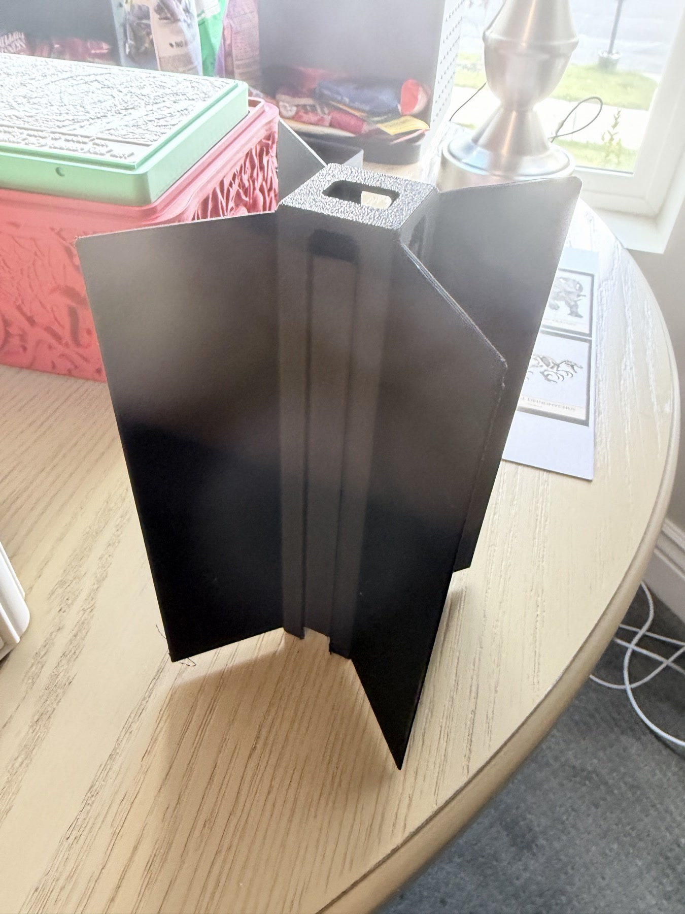

# Standard lighting architectures

Use these names consistently in Dave's lantern projects. Record the selected architecture in the project checkpoint before functional blockout.

## Split lighting

Selecting **split lighting** imports the following system together. Do not substitute a generic PCB, battery, divider, or LED layout while continuing to call the result split lighting. Record any explicit exception as a project-specific departure.

### Controller and power baseline

- Controller PCB proposal: 88 × 50 × 1.6 mm with 3 mm corner radius.
- Minimum board cavity: 94 × 56 × 25 mm.
- Wired controller envelope: 94 × 85 × 25 mm, excluding the separate antenna.
- Preserve a 20 mm straight USB plug approach at the service edge and 15 mm beyond the harness edge for connector bodies and wire bends.
- Four 3.2 mm mounting holes, top view from the PCB lower-left origin: `(44,4)`, `(84,4)`, `(4,46)`, `(84,46)` mm. The pattern is asymmetric; do not mirror it. Use nonconductive 3 mm standoffs.
- Controller: Seeed Studio XIAO ESP32-S3.
- LED data path: XIAO D1 / GPIO2 through an SN74AHCT125N 5 V level shifter to the `+5 V / DATA / GND` light connector.
- Retained charger/5 V boost daughterboard M1: 34.39 × 25.53 × 5 mm actual, with a 36.4 × 27.5 mm plan reservation.
- Battery: protected 3.7 V single cell, 40 × 65 × 12 mm actual. Reserve a provisional 42 × 67 × 14 mm removable, non-compressive pocket with strain relief and an extraction path.
- XIAO battery pads remain unused. Add the required Schottky isolation diode between external `+5V_SYS` and the XIAO 5V/VBUS input before fabrication.
- The retained M1 architecture has physically operated the lights while USB-C charging in another lantern. Repeat staged powered and thermal testing in each final enclosure.
- External adhesive antenna: 38 × 19 × 3 mm; reserve at least 40 × 21 × 4 mm on a flat nonmetallic surface. Use a gentle, serviceable U.FL lead route and keep the antenna away from the battery, M1, large metal parts, and ground planes where practical.

### Divider and light baseline

- Use an opaque, removable divider built as a hollow central post with four radial light-blocking blades. Together, the post and blades create four face-oriented optical chambers, one per lithophane.
- Orient the divider so each of the central post's four flat faces points toward the center of one lithophane. Each lithophane sits between two adjacent radial blades; the blades form the chamber sidewalls and prevent light intended for one lithophane from spilling directly behind its neighbors.
- Run each blade outward toward the opaque corner/frame line between adjacent lithophanes. Its outer edge must meet or overlap the lantern's light-blocking frame region rather than terminate in the illuminated image field.
- Run the divider continuously between keyed base and roof seats. Preserve the hollow center as a protected vertical wiring/service passage, including usable entry and exit openings.
- The divider must not block panel installation, panel removal, roof removal, or controller service.
- Provide one vertical recessed or positively located LED-strip channel on each of the four central post faces.
- Mount one vertical addressable-LED strip in each channel, aimed outward toward the corresponding lithophane: four strips of equal length, `4 × N` pixels total. Keep the LEDs and channel edges clear of the two adjacent divider blades so the full lithophane field receives light.
- Standard strip: BTF-LIGHTING WS2812B, 5 V, 144 LEDs/m (pitch about 6.94 mm), Amazon ASIN B01CDTE9UC. Measure the purchased strip's width, thickness and pixel pitch before fixing the channel; record any other strip as a project-specific departure.
- Derive the pixel count per strip from the lantern, not a fixed number: `N = floor((H_field − 2 × m) / p)`, where `H_field` is the exposed lithophane image height, `m` is an end margin (start at 2 mm) and `p` is the measured pitch. Center each strip vertically on its panel's field, and use the same `N` on all four faces. Example: a 165 mm field at 144/m gives `N = 23` (about 160 mm), so 92 pixels total.
- Daisy-chain `DIN→DOUT` around the post across the four strips as one `4 × N`-pixel serial data chain connected to the controller's single light output. In this definition, “wired in serial” refers to the addressable data order; preserve a correctly sized, serviceable 5 V/GND distribution path rather than placing the strip power rails electrically in series.
- Reference firmware/load configuration: WLED with an 850 mA current limit and the LED count set to `4 × N`. The limit, not the pixel count, bounds the load: more pixels at the same limit spread the same current over a taller field. Re-check current, voltage drop, wiring, connector capacity, battery runtime, and heat before raising the limit, and confirm the voltage drop along the chain for the derived `N`.

### Governing divider-to-frame relationship

These relationships are part of the split-lighting definition even though their numerical dimensions change with the lantern:

- **The divider is full optical height, not a short insert.** Its body runs from a positive seat on the base/light-carrier structure to a positive seat at the underside of the roof or top frame. Its blades must block direct chamber-to-chamber sightlines across the entire exposed lithophane image height.
- **Derive its height from the inside of the assembled frame.** The governing dimension is the distance between the lower divider seat and upper divider seat, including any keyed engagement and assembly clearance. Do not derive divider height from overall lantern height or stop it at the end of the LED strip.
- **Top and bottom transitions stay behind opaque frame coverage.** A blade may end slightly above or below the physical lithophane edge only where the opaque top or bottom capture rail overlaps that region. No vertical gap may expose one illuminated chamber to another through the visible lithophane field.
- **The divider nests entirely inside the outside frame.** It is an internal optical and LED carrier, not an exterior wall, corner post, lithophane capture frame, or silhouette-defining part.
- **Each blade ends at a panel-bay junction.** In plan view, its outer tip points to and meets the inside of the opaque vertical corner/frame member between two neighboring lithophanes. It must not terminate behind the middle of a lithophane or cross its panel channel.
- **Use light-blocking overlap rather than structural substitution.** The outer frame continues to locate and retain the lithophanes. The blade end may use a keyed pocket, shallow slot, labyrinth overlap, or close removable fit at the frame's inner corner. Small assembly clearance is acceptable only when hidden by opaque overlap and shown not to leak objectionable light.
- **Keep service systems independent.** Removing the divider must not require flexing the lithophanes or dismantling the outside frame unless the project's approved assembly order explicitly says otherwise.

Simplified top section:

```text
                 LITHOPHANE
          ┌─────────────────────┐
          │      chamber        │
          │         ↑           │
          │       LED face      │
 FRAME ───●─────────□───────────●─── FRAME
          │ blade  central  blade│
          │        post          │
          │                       │
 LITHO ←  │ chamber       chamber│  → LITHO

● = opaque outside-frame junction between adjacent panel bays
□ = hollow central post; one outward-facing LED strip per face
```

Simplified vertical section:

```text
        roof / opaque top frame
      ┌──────────────────────────┐
      │ keyed upper divider seat │
      ├──────────────────────────┤ ← opaque overlap
      │                          │
      │ exposed lithophane field │ ← divider blocks full height
      │                          │
      ├──────────────────────────┤ ← opaque overlap
      │ keyed lower divider seat │
      └──────────────────────────┘
        base / light carrier
```

### Physical divider reference

These user-supplied photos define the intended spatial relationship. Treat them as form and assembly evidence, not dimensioned drawings.


The installed view shows one lithophane facing each central post face. Adjacent radial blades extend toward the opaque corner/frame regions and separate the four optical chambers.



The isolated view shows the hollow central wire passage, four vertical strip channels on the post, and the radial baffle blades. Preserve this topology when adapting the divider height and span to a new lantern.

### Variables that remain lantern-specific

The name locks the system topology and established hardware envelopes, but not every geometric or optical dimension. Determine and verify for each lantern:

- numerical divider height derived from the base-to-roof seat distance, blade span and thickness, central-post section, strip-channel fit, interlock, and base/roof key geometry;
- perimeter light sealing, reflectivity, diffuser use, and seam leakage;
- pixel count per strip `N` derived from the field height and measured pitch, and the resulting strip length and channel length;
- LED-to-lithophane spacing, panel thickness range, color balance, and hotspot control;
- final harness lengths, power injection, connector selections, wire gauge, and service routing;
- enclosure fit, antenna performance, powered temperature, and runtime.

Use a divider/key/light-seal coupon, one representative chamber optical coupon, and a controller-carrier fit check before release claims.

## Puck light

**Puck light** is a separate standard architecture name. Use the actual selected low-voltage puck's measured envelope, switch, charging or battery access, removal path, and optical spacing. Do not import the split-lighting PCB, battery, X divider, or strip topology unless the user explicitly requests a hybrid. Add a locked puck baseline here only after the user approves a specific reusable setup.

## Tea light

**Tea light** is a separate standard architecture name for an LED tea light only; open flame remains excluded. Use the actual light's measured diameter, height, flame/lens envelope, switch access, battery door, and removal path. Do not import the split-lighting PCB, battery, X divider, or strip topology unless the user explicitly requests a hybrid. Add a locked tea-light baseline here only after the user approves a specific reusable setup.
